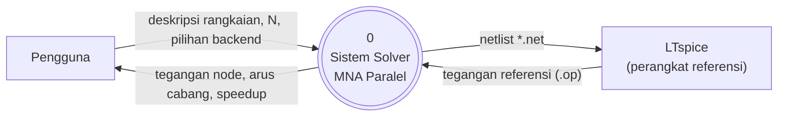
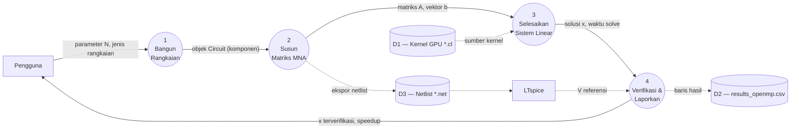
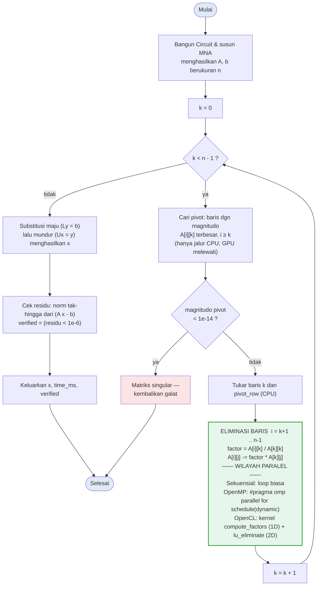
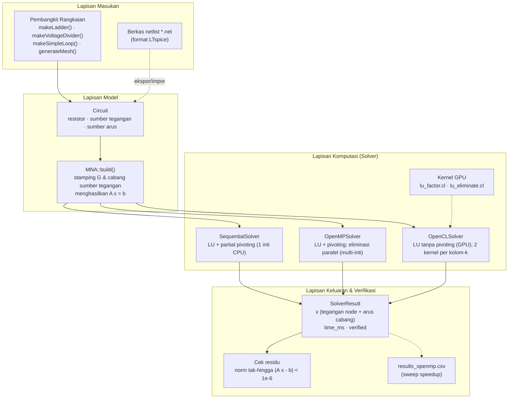

# Diagram Mermaid — Solver MNA Paralel

Empat diagram di bawah dapat dirender langsung di GitHub, VS Code (ekstensi
Mermaid), Notion, Obsidian, atau di <https://mermaid.live>.

---

## 1. DFD Level 0 (Diagram Konteks)

---

## 2. DFD Level 1

---

## 3. Flowchart — Algoritma Solver LU

Blok hijau adalah **wilayah paralel** yang diimplementasikan berbeda pada tiap
backend (sekuensial / OpenMP / OpenCL).

---

## 4. (Bonus) Arsitektur Sistem

